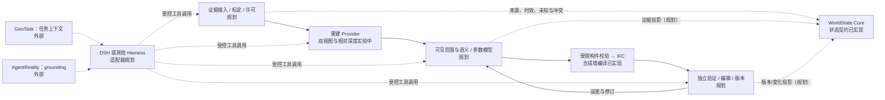
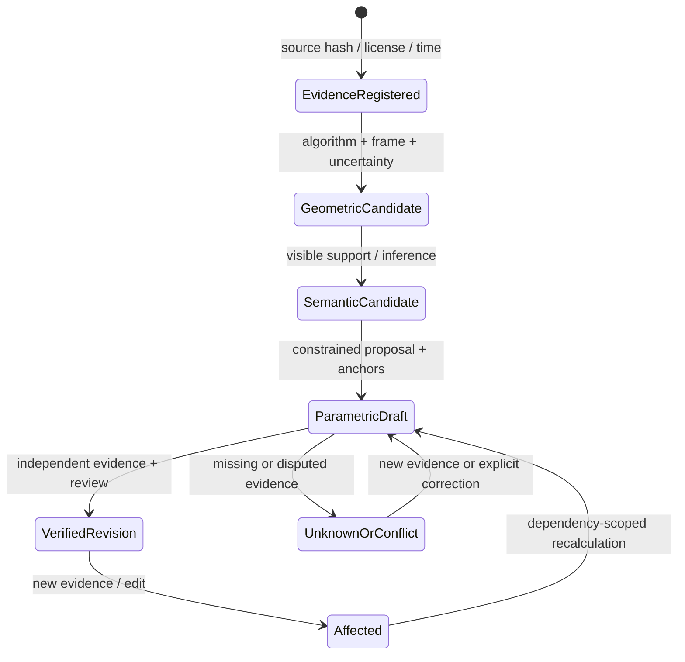
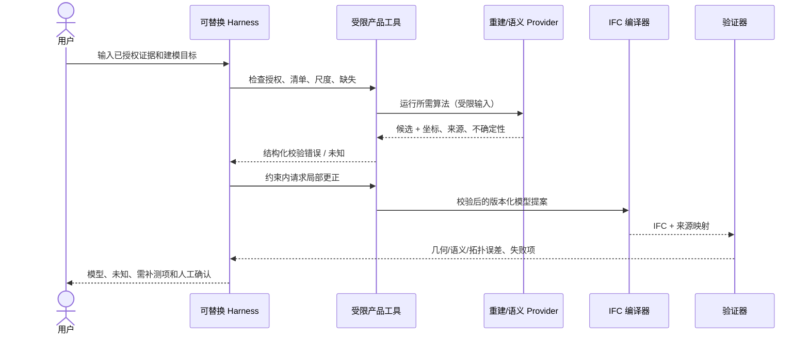

# WorldState — Evidence-to-Editable World

架构草案，2026-11-13。图例：**已实现**仅指可运行的现有局部能力；**实验中**不代表产品可用；**规划**未实现。矢量总图见 [SVG](evidence-to-editable-world.svg)，决策见 [ADR 0004](../adr/0004-evidence-to-editable-product-scope.md)。

## 能力、数据与控制流

实现顺序以真实房间为主线，不建设长期运行时。照片少/未标定时使用不确定的先验候选和用户补测；密集重叠照片可尝试 SfM/MVS；有深度/点云时使用显式传感器融合。所有路线在独立尺度、坐标、采集时间和遮挡上须说明依据。

## 对象生命周期（规划，已有 GUID 机制可复用）

不可将 `VerifiedRevision` 简化成某个模型的 confidence。可见面、不可见厚度及门窗开口等属性应分别追溯。历史版本不覆盖；删除/拆分/合并应有显式身份事件，不能只依据新几何重新生成 ID。

## Harness 建模与修复时序（规划）

## 建议契约（均未冻结、除现有 proposal 外未实现）

| 契约 | 最小字段/行为 | 不变量 |
| --- | --- | --- |
| `EvidenceAsset` | 内容 hash、来源与许可、捕获时间、媒体、坐标/内参、获取方式 | 保留时间/许可未知；外部路径须受权限约束。 |
| `GeometryCandidate` | provider/version、输入哈希、坐标系、单位与尺度依据、点/面、相机、可见性和不确定性 | 不把未知尺度写成米；候选可重放，算法不得被当作真值。 |
| `ElementCandidate` | 稳定 ID、类别、参数与每个属性的证据/观测模式、拓扑依赖、待确认 | 墙面可见不推断已知厚度；保留冲突值。 |
| `ModelRevision` | 输入版本、构件映射、修改操作、影响闭包、评测、不可变父版本 | 局部修改后重跑依赖检查、几何/拓扑与来源校验；回滚为新版本。 |
| Provider / Harness seam | typed input → candidates/errors；受控 `inspect`, `validate`, `compile`, `compare`, `revise` | 模型只建议结构化值；提供商或 Harness 替换不改变产品语义。 |

Core 现有 `StateAssertion | Unknown | Conflict` 与历史/变化接口可承载经过验证的状态投影，但产品需要先明确属性粒度、坐标和时效映射；这项集成尚未编写。当前 `proposal/0.1` anchor 只有声明，不能证明尺度已应用。

## 风险与验证

以带真实尺寸和授权的完整房间为 V0.2 目标；TUM 的 RGB-D 轨迹只用于前期几何实验，没有真实墙或 IFC 真值。必须增加独立尺度及留出照片核验、Bonsai/其他编辑器打开修改回读、GUID 保持与人工耗时对照，再评估 V0.2 发布。V0.3–V1.0 的具体门槛见 [路线图](../roadmap/worldstate-bim-product-reset.md)。
